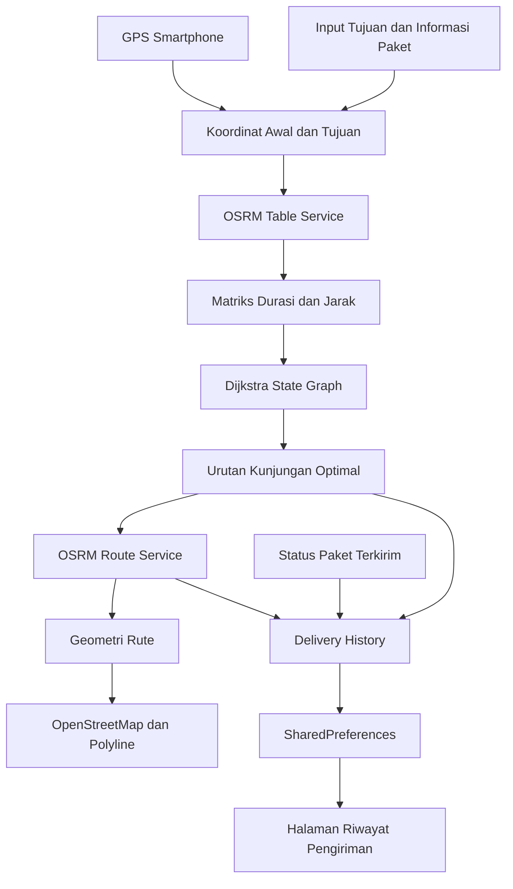

# Smart Delivery Dijkstra

Aplikasi pengiriman barang berbasis Flutter Android yang mengintegrasikan OpenStreetMap, GPS, OSRM, dan algoritma Dijkstra pada state graph untuk menentukan urutan kunjungan dengan estimasi waktu tempuh minimum.


## Informasi Project

| Keterangan     | Informasi                         |
| -------------- | --------------------------------- |
| Mata Kuliah    | Pemrograman Basis Mobile          |
| Pertemuan      | 12                                |
| Program Studi  | Informatika                       |
| Universitas    | Universitas Katolik Musi Charitas |
| Dosen          | Dr. Latius Hermawan, S.T., M.Kom. |
| Platform       | Android                           |
| Versi Aplikasi | 1.1.0+2                           |

## Fitur Aplikasi

### Praktikum

- Pengambilan lokasi awal menggunakan GPS.
- Peta interaktif berbasis OpenStreetMap.
- Penambahan titik tujuan melalui long-press.
- Matriks durasi dan jarak melalui OSRM Table Service.
- Optimasi urutan kunjungan menggunakan Dijkstra pada state graph.
- Polyline berdasarkan geometri jaringan jalan.
- Penyesuaian kamera terhadap seluruh rute.
- Ringkasan total jarak dan estimasi waktu perjalanan.
- Antarmuka Material Design 3 yang responsif.
- Validasi input dan penanganan kesalahan.

### Tugas Mandiri

- Jumlah tujuan dinamis antara 3 sampai 8.
- Input nama penerima dan deskripsi paket.
- Marker berdasarkan urutan kunjungan optimal.
- Tombol tandai paket terkirim.
- Perubahan warna marker menjadi hijau setelah paket terkirim.
- Ringkasan jumlah paket selesai.
- Indikator progres pengiriman.
- Penyimpanan riwayat pengiriman terakhir menggunakan local storage.
- Halaman riwayat pengiriman.
- Persistensi riwayat setelah aplikasi ditutup.
- Reset rencana pengiriman tanpa menghapus riwayat terakhir.

## Teknologi

| Teknologi          | Versi  | Fungsi                                 |
| ------------------ | ------ | -------------------------------------- |
| Flutter            | 3.38.1 | Framework pengembangan aplikasi        |
| Dart               | 3.10.0 | Bahasa pemrograman                     |
| flutter_map        | 8.3.2  | Peta, marker, dan polyline             |
| latlong2           | 0.10.1 | Representasi koordinat geografis       |
| geolocator         | 14.1.2 | GPS dan permission lokasi              |
| http               | 1.6.0  | Komunikasi HTTP dengan OSRM            |
| url_launcher       | 6.3.2  | Membuka attribution OpenStreetMap      |
| shared_preferences | 2.5.5  | Penyimpanan riwayat lokal              |
| OpenStreetMap      | -      | Data peta dan jaringan jalan           |
| OSRM               | -      | Matriks waktu tempuh dan geometri rute |
| Material Design 3  | -      | Desain antarmuka                       |

## Arsitektur Sistem



## Algoritma Dijkstra

Aplikasi menggunakan Dijkstra pada state graph untuk menentukan urutan kunjungan seluruh tujuan.

Setiap state terdiri dari dua komponen:

- currentNode: posisi kendaraan saat ini.
- visitedMask: representasi bitmask tujuan yang telah dikunjungi.

Bobot antar titik menggunakan estimasi durasi perjalanan dari OSRM, bukan jarak garis lurus.

Algoritma mencari state dengan total biaya minimum sampai seluruh tujuan telah dikunjungi. Setelah urutan optimal diperoleh, OSRM Route Service menyediakan geometri jalan yang digunakan untuk menggambar polyline.

Jumlah tujuan dibatasi maksimal delapan untuk mengendalikan pertumbuhan jumlah state yang bersifat eksponensial.

## Struktur Project

```text
smart_delivery_dijkstra/
├── android/
├── docs/
│   ├── screenshots/
│   └── jawaban_pertanyaan_diskusi.md
├── lib/
│   ├── main.dart
│   ├── models/
│   │   ├── delivery_history.dart
│   │   ├── delivery_stop.dart
│   │   └── route_models.dart
│   ├── screens/
│   │   ├── delivery_history_page.dart
│   │   └── delivery_map_page.dart
│   └── services/
│       ├── dijkstra_service.dart
│       ├── local_storage_service.dart
│       ├── location_service.dart
│       └── osrm_service.dart
├── test/
│   ├── delivery_history_test.dart
│   └── dijkstra_service_test.dart
├── .gitignore
├── analysis_options.yaml
├── pubspec.yaml
├── pubspec.lock
└── README.md
```

## Persyaratan Sistem

- Flutter SDK 3.38.1.
- Dart SDK 3.10.0.
- Android SDK Platform 36.
- Java Development Kit 17.
- Smartphone Android minimal API 24.
- Koneksi internet.
- GPS aktif.
- USB Debugging untuk pengujian perangkat.

## Instalasi Project

Clone repository:

```bash
git clone https://github.com/frytn13/pemrogramanbasisweb-pertemuan12-OpenStreetMap-dan-Flutter-Integration.git
```

Masuk ke direktori project:

```bash
cd pemrogramanbasisweb-pertemuan12-OpenStreetMap-dan-Flutter-Integration
```

Unduh dependencies:

```bash
flutter pub get
```

Periksa perangkat Android:

```bash
flutter devices
```

Jalankan aplikasi:

```bash
flutter run
```

## Cara Menggunakan Aplikasi

1. Buka aplikasi Smart Delivery Dijkstra.
2. Berikan izin akses lokasi.
3. Tunggu hingga marker lokasi awal muncul.
4. Tentukan jumlah tujuan antara 3 sampai 8.
5. Tekan lama pada peta untuk menambahkan titik tujuan.
6. Isi nama penerima dan deskripsi paket.
7. Lengkapi seluruh titik tujuan.
8. Tekan Hitung Rute Dijkstra.
9. Lihat urutan kunjungan, polyline, jarak, dan estimasi waktu.
10. Tandai paket sebagai terkirim setelah pengiriman selesai.
11. Periksa progres pengiriman.
12. Buka halaman riwayat untuk melihat pengiriman terakhir.

## Pengujian

Pengujian dilakukan menggunakan smartphone Android nyata.

| Parameter               | Keterangan                 |
| ----------------------- | -------------------------- |
| Perangkat               | Realme 5s                  |
| Sistem Operasi          | Android 13                 |
| Android API             | 33                         |
| Arsitektur              | ARM64                      |
| Environment Development | Fedora Linux 45 KDE Plasma |
| IDE                     | Visual Studio Code         |

### Hasil Pengujian

| Pengujian                        | Hasil    | Status |
| -------------------------------- | -------- | ------ |
| Static Analysis                  | 0 issue  | PASS   |
| Dijkstra Unit Testing            | 10/10    | PASS   |
| DeliveryStop Model               | 3/3      | PASS   |
| DeliveryHistory Model            | 6/6      | PASS   |
| LocalStorageService              | 6/6      | PASS   |
| Functional Testing Praktikum     | 15/15    | PASS   |
| Functional Testing Tugas Mandiri | 23/23    | PASS   |
| Build APK Release                | Berhasil | PASS   |
| Instalasi APK Release            | Berhasil | PASS   |

Hasil pengujian tersebut merupakan hasil kumulatif dari tahap praktikum dan tugas mandiri.

### Menjalankan Unit Testing

```bash
flutter analyze
flutter test
```

## Build APK Release

```bash
flutter build apk --release
```

Lokasi hasil build:

```text
build/app/outputs/flutter-apk/app-release.apk
```

| Parameter              | Keterangan               |
| ---------------------- | ------------------------ |
| Version Name           | 1.1.0                    |
| Version Code           | 2                        |
| Application ID         | id.ac.ukmc.smartdelivery |
| Compile SDK            | 36                       |
| Target SDK             | 36                       |
| Minimum SDK            | 24                       |
| Ukuran APK hasil build | 51,3 MB                  |

## Dokumentasi

- [Jawaban Pertanyaan Diskusi Pertemuan 12](docs/jawaban_pertanyaan_diskusi.md)
- Screenshot bukti pengujian ditempatkan pada direktori `docs/screenshots/`.

## OpenStreetMap dan OSRM

Aplikasi menggunakan data OpenStreetMap serta layanan routing OSRM untuk kebutuhan pembelajaran dan praktikum.

Attribution OpenStreetMap contributors ditampilkan pada peta aplikasi.

Public tile server dan public routing server digunakan untuk pengujian ringan. Penggunaan dalam aplikasi produksi berskala besar memerlukan infrastruktur atau penyedia layanan yang sesuai dengan kebijakan penggunaan.

## Referensi

- Modul Praktikum Pemrograman Basis Mobile Pertemuan 12.
- [Flutter Documentation](https://docs.flutter.dev/)
- [flutter_map Documentation](https://docs.fleaflet.dev/)
- [OpenStreetMap](https://www.openstreetmap.org/)
- [OpenStreetMap Copyright](https://www.openstreetmap.org/copyright)
- [OpenStreetMap Tile Usage Policy](https://operations.osmfoundation.org/policies/tiles/)
- [OSRM Documentation](https://project-osrm.org/docs/)

---

Project ini dikembangkan untuk memenuhi Praktikum dan Tugas Mandiri Pemrograman Basis Mobile Pertemuan 12, Program Studi Informatika, Universitas Katolik Musi Charitas.
